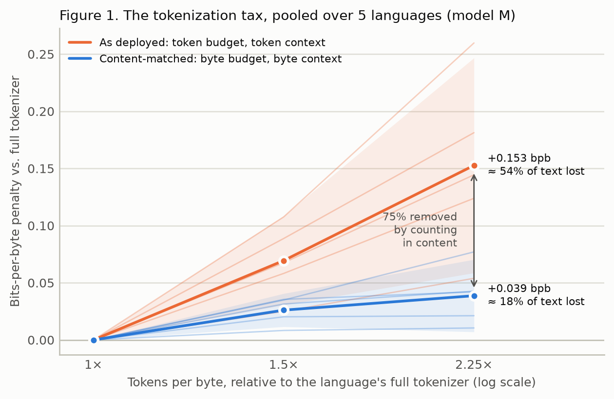

# Who pays the token tax?

High-fertility languages (more tokens per byte) are usually also low-data languages, and every
budget that touches them is counted in tokens. This study holds the text fixed, changes only how
much vocabulary the tokenizer allocates (1×, 1.5× and 2.25× tokens per byte), and counts the
training budget and the context window both in tokens and in bytes. It asks how much of the
quality penalty is fertility itself, and how much is token-denominated accounting.

**Result.** At 2.25× fertility, counting in content removes 75% of the penalty (95% CI 69–89%)
for the 17M-parameter model, so the preregistered hypothesis that accounting dominates holds. A
content-matched residual of 0.039 bits per byte (95% CI 0.007–0.070) remains, as costly as losing
18% of the training text. The write-up is [REPORT.md](REPORT.md); the hypotheses, design and
analysis plan, committed before any model was trained and amended only with dated entries, are
[PREREGISTRATION.md](PREREGISTRATION.md).



## The design in one table

Per (language, model, seed): three dose levels on byte-identical training text, every causal
contrast inside one language.

| Cell | Training budget | Eval context | What it is |
|---|---|---|---|
| D(tok, tok) | reference token count T | 512 tokens | the penalty deployed systems impose |
| D(byte, tok) | one pass over the content | 512 tokens | |
| D(tok, byte) | T tokens | round(512 r) tokens | |
| D(byte, byte) | one pass over the content | round(512 r) tokens | the content-matched residual |

The Shapley average over the two orders of {budget, context} splits
D(tok, tok) = D(byte, byte) + φ_budget + φ_context exactly; the headline is
S = 1 − D(byte, byte) / D(tok, tok) at r = 2.25.

## Repository

```
configs/study.yaml    every number in the design; the code reads nothing else
src/recount/
  data/      FineWeb-2 row-group sampler, byte premiums, FLORES-200, 13-gram decontamination
  tok/       dose tokenizers (prefixes of one merge list in a fixed id space), dose search, shards
  train/     document-order streams (common random numbers), run grid with cooldown branches,
             trainer, run queue
  eval/      bits per byte under both context protocols, context-shuffle and stride controls,
             the canonical-tokenization gap, the XGLM check
  analysis/  decomposition, HKSJ meta-analysis, TOST, Fieller interval for S, power by
             simulation, simulator with known truth, figures, appendix tables, sealing
  table1.py  token premiums of production tokenizers on FLORES-200
  smoke.py   the whole pipeline on synthetic text on the CPU (~1 minute)
src/microlm/ the model, optimizer, schedules, checkpoints, and run hashing, vendored
             unchanged from micro-lm-ablations (see src/microlm/VENDORED.md)
queues/      the pilot and main-grid job lists
results/     every endpoint, the analysis, figures, appendix tables, Table 1, the XGLM check
sealed/      the pilot's level contrasts, opened after the main analysis (hashes in results/seals/)
```

## Reproducing it

```bash
python3.12 -m venv .venv && .venv/bin/pip install -e ".[data,analysis,dev,table1]"
make test smoke          # unit tests, and the whole pipeline on synthetic text on the CPU
make sim power           # the preregistered analysis on simulated data; power by simulation
make data tokenizers     # FineWeb-2 samples -> data/text/<lang>/; tokenizers and shards -> data/
make table1              # Table 1 from FLORES-200
make plan-main           # the main grid's job list -> queues/main.yaml
python -m recount.train.queue queues/main.yaml   # train and evaluate every job, in order (GPU)
make analysis appendix   # the preregistered analysis and the appendix tables
make figures RUNS=results/all_runs.csv
```

`requirements.txt` pins the versions the models were trained and evaluated with. Data under
`data/` is git-ignored and rebuilt from the manifests: every document keeps its FineWeb-2 id,
crawl dump, and URL.

## Conventions

| Quantity | Definition |
|---|---|
| Dose r | tokens per byte under the dose tokenizer ÷ under the language's full 16,384-entry tokenizer, on held-out text |
| Bits per byte | total nats over every target token of the evaluation stream ÷ its UTF-8 bytes ÷ ln 2; each target scored exactly once |
| Content | byte premium (vs. English) × 600 MB per language; model S reads the first third |
| Reference budget T | tokens of the content under the full tokenizer |
| SESOI | b · ln(1/0.9): the cost of losing 10% of the training text, b = data-curve slope |

## Citation

If you use this work, please cite it. GitHub's **Cite this repository** button gives the same
entry from [CITATION.cff](CITATION.cff).

```bibtex
@misc{detroja2026tokentax,
  author       = {Detroja, Vraj},
  title        = {{Who pays the token tax?} Fertility or accounting in the quality penalty of
                  high-fertility languages},
  year         = {2026},
  month        = oct,
  howpublished = {\url{https://github.com/vrajdetroja/who_pays_the_token_tax}},
  note         = {Preregistered study}
}
```

## License

The code and documents are released under the [MIT License](LICENSE). The data the study uses
keep their own licenses and are not redistributed here: FineWeb-2 (ODC-By 1.0), FLORES-200
(CC BY-SA 4.0; one devtest sentence is quoted in `results/appendix/segmentation.md`), and the
XGLM checkpoints (MIT).
