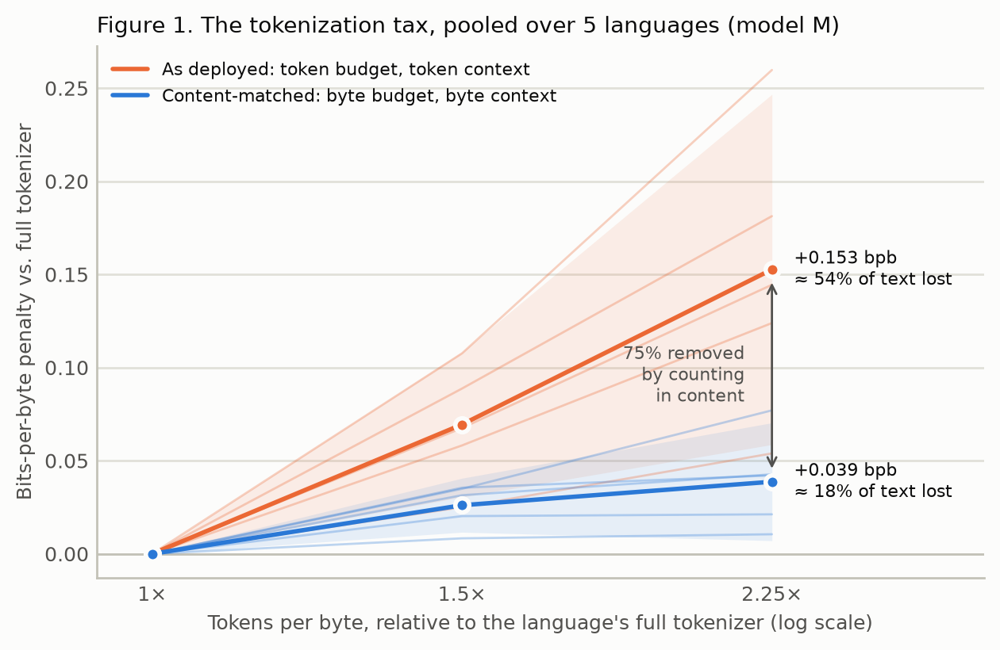
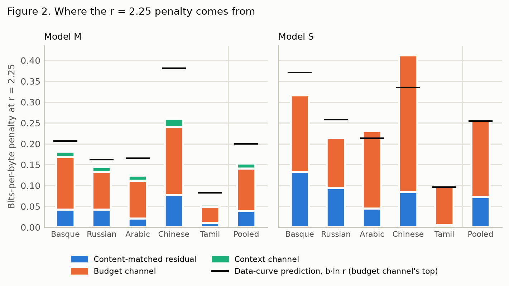

# Who pays the token tax?

**Fertility or accounting: decomposing the quality penalty of high-fertility languages, within a
language, at fixed text**

Vraj Detroja · 31 October 2026

A report of a preregistered study. The hypotheses, design and analysis plan were committed in
[PREREGISTRATION.md](PREREGISTRATION.md) before any model was trained, and every later change is
a dated amendment in the same file.

## Abstract

Languages that tokenizers split into more tokens per byte are widely held to be modeled worse,
not only billed more. The evidence compares languages, where high fertility travels with scarce
data, and counts every budget in tokens. This study holds the text fixed. In five languages
(Arabic, Basque, Chinese, Russian, Tamil), small language models are trained on byte-identical
text with tokenizers that differ only in vocabulary allocation (1×, 1.5× and 2.25× tokens per
byte), and bits per byte are measured with the training budget and the context window each
counted in tokens or in bytes: 408 model endpoints at two sizes (7M and 17M parameters), with
negative and positive controls, under an analysis preregistered before any model was trained. For
the 17M-parameter model at 2.25× fertility, counting in content removes 75% of the penalty (95%
CI 69–89%), so the registered hypothesis that accounting dominates is supported. But a
content-matched residual of 0.039 bits per byte (95% CI 0.007–0.070) remains, as costly as
discarding 18% of the training text. Fertility is mostly an accounting problem, and data
mixtures, context limits and evaluation budgets should be stated in content rather than tokens;
it is not only one, because with equal text, equal context in bytes and more compute per byte,
finer segmentation still costs quality.

## 1. Introduction

Multilingual tokenizers split some languages into far more tokens than others. The same 1,012
FLORES-200 sentences take, on average over six production tokenizers, 1.38 times as many tokens
in Arabic as in English, 2.69 times in Tamil and 5.41 times in Burmese ([Table 1](#49-the-stakes)).
The premium is well documented (Petrov et al., 2023; Ahia et al., 2023), and because APIs bill
per token and context windows are counted in tokens, it is a cost and a context penalty by
construction. Whether it is also a quality penalty is less clear. Fertility correlates with
lower accuracy across languages (Lundin et al., 2026), but across languages fertility travels
with data scarcity, and every budget that touches a language (training tokens, context windows,
evaluation budgets) is counted in tokens. A language that needs 2.25 times the tokens for the
same text gets, under a fixed token budget, less than half its text, and in a fixed token window,
less than half the context.

Two readings follow. If the penalty is mostly accounting, it disappears when budgets are counted
in content, and the fix is bookkeeping. If a residual survives content-matched accounting, finer
segmentation is costly in itself, and vocabulary allocation is a fairness lever in its own right.

This study separates the two inside each language, at fixed text. For each of five languages it
builds one 16,384-entry tokenizer and two finer variants that keep only its first merges, so the
same text costs 1×, 1.5× or 2.25× the tokens. Models are trained and evaluated with the training
budget and the evaluation context each counted in tokens or in bytes, and the as-deployed penalty
is decomposed exactly into a budget channel, a context channel and a content-matched residual.

The contributions:

- **A decomposition** of the fertility quality penalty, within a language at fixed text, into
  token-accounting channels and a content-matched residual, with a preregistered test of which
  dominates. Accounting removes 75% [69%, 89%] of the penalty at 2.25×; the residual, 0.039 bits
  per byte [0.007, 0.070], is real.
- **A controlled dose ladder**: vocabulary allocation varied on byte-identical training text, with
  identical parameters at every level and unreachable tokens masked out of the softmax.
- **An exchange rate between fertility and data**: every penalty expressed as the share of the
  training text whose loss would cost as much (54% as deployed, 18% content-matched, at 2.25×).

## 2. Related work

**Compute-optimal tokenization.** Limisiewicz et al. (2026) train 988 byte-level models from 50M
to 7B parameters and find that compute-optimal parameter counts scale with bytes and that the
optimal compression rate differs by language. That is a compute-optimality result; this study
decomposes the penalty a given allocation imposes.

**Controlled tokenizer comparisons.** Meister, Altıntaş & Bosselut (2026) train 123 models over 54
tokenizers with architecture, corpus, training-token budget and optimization fixed, and find
that tokenizer choice matters more for lower-resource languages: the as-deployed regime of this
study, without its byte-accounted counterpart. Regmi, Pudasaini & Pun (2026) train three
268M-parameter models that differ only in the tokenizer; their coarser Nepali tokenizer has 4.43%
lower bits per byte at equal compute and still leads at equal bytes with 1.59× the compute. That
single content-matched contrast points the way this study's residual does, in five languages.
TokSuite compares tokenizers at a fixed token budget and notes that 100B tokens are 100, 278 or
471 GB of text depending on the tokenizer, and Chaudhary (2026) finds that matching training steps
instead of data reverses a tokenizer ranking: the accounting unit can change a verdict, and
neither decomposes it. Ali et al. (2024) ask whether tokenizer choice matters for LLM training,
and Tao et al. (2024) fit scaling laws with vocabulary size.

**The cost side.** Petrov et al. (2023) measure the premium on parallel text, Ahia et al. (2023)
price it, and Mandarapu & Kunkunuru (2026) split the token-cost ledger into removable and
irreducible parts while making no claim about model quality; this study is the quality-side
counterpart. Arnett, Chang & Bergen (2024) define the byte premium used here to size each
language's data.

**Measurement.** Yang, Wilcox & Arnett (2026) recommend sentence-level likelihood on parallel
data for comparing languages, the secondary metric here. Chirkova et al. (2023) show that scoring
only the canonical tokenization overstates a text's loss, which §4.7 measures. Cooldown branches
as endpoints follow Hägele et al. (2024).

## 3. Method

### 3.1 Construct and operationalization

The construct is whether a language's higher token count per unit of content makes models worse
at that language, beyond what it costs in budget. It is operationalized as the bits-per-byte
penalty of models trained on identical text with tokenizers that allocate 1×, 1.5× and 2.25×
tokens per byte, evaluated under token- and byte-denominated training budgets and context windows.

| Construct | Operationalization | Gap |
|---|---|---|
| Fertility (dose r) | tokens per byte under the dose tokenizer ÷ under the language's full 16,384-entry tokenizer, on held-out text: 1.0, 1.5, 2.25 (±3%) | Fertility from vocabulary allocation, not from differences between languages |
| Model quality | bits per UTF-8 byte (BPB) on held-out FineWeb-2 (primary); FLORES-200 devtest in bits per sentence (secondary) | Next-byte prediction, not task competence; small models |
| Accounting regime | training budget in tokens (the reference's token count T) or bytes (one pass over the content); evaluation context of 512 tokens or round(512 r) tokens | One context length |

### 3.2 Languages and data

Arabic (arb_Arab), Basque (eus_Latn), Chinese (cmn_Hani; FLORES zho_Hans), Russian (rus_Cyrl) and
Tamil (tam_Taml): five scripts, two of them (Han and Tamil) three bytes per character. Text comes
from FineWeb-2 (Penedo et al., 2025), sampled by random row group across up to 40 files per
language. Each language's training content is 600 MB × its byte premium (Arnett, Chang & Bergen,
2024), from 636 MB of Basque to 1.64 GB of Tamil, so every language gets the same
English-equivalent content; model S reads the first third. The tokenizer samples (200 MB) are
disjoint from the content, the held-out evaluation set (2 MB × premium) comes from FineWeb-2's
test split, and every set is decontaminated against FLORES-200 dev and devtest by 13-grams.

### 3.3 Tokenizers and the dose

One byte-level BPE tokenizer per language: 16,384 entries (256 bytes, 16,127 merges, one
separator), with GPT-4's pre-tokenization pattern and combining marks kept with their letters, as
in o200k_base. A dose level keeps the first k merges, with k found by binary search on a
dose-search set so that the level costs 1.5 or 2.25 times the full tokenizer's tokens per byte,
and verified on held-out text within ±3%. On FLORES-200 devtest, which no tokenizer saw, the
levels come out 1–4% below their held-out values. Tokens a level can never produce keep their
rows in the embedding table, so every level has identical parameters and identical ids for shared
tokens, and those rows are masked out of the softmax in training and evaluation. Unmasked, a tiny,
undertrained model on the real Basque shards left 14–84% of its probability on impossible tokens,
which would have biased the result toward accounting. Table 1 places production tokenizers on
this axis: Tamil sits between 1.1× (BLOOM) and 5.4× (Qwen3), so 2.25× is inside the range
deployed tokenizers impose.

### 3.4 Models and training

Pre-norm decoder-only Transformers with rotary positions, GELU MLPs, tied embeddings and no
biases: **M**, 6 layers × 384 wide × 6 heads (10.6M non-embedding and 6.3M embedding parameters),
and **S**, 4 × 256 × 4 (3.1M and 4.2M). AdamW (β = 0.9, 0.95; weight decay 0.1; clipping 1.0) at a
learning rate of 1e-3 at every level, warmup–stable–decay with a linear cooldown over the last 20%
of every endpoint, bf16 autocast, 64 windows per step. A window is round(512 r) tokens (512, 768,
1,152), so every step reads the same bytes on average. Within a seed, every level starts from the
same initialization and reads the same documents in the same order. Model M has seeds 0–4 and
model S seeds 0–2: 40 (language, model, seed) units.

### 3.5 Accounting regimes and the decomposition

Each unit trains a reference at r = 1 and one run at each dose, all on one pass over the content,
and branches cooldowns from them:

| Run | Endpoints |
|---|---|
| r = 1 (reference) | final; data-curve branches at 12.5, 25 and 50% of the content; identity branches that read exactly the bytes each as-deployed branch reads |
| r = 1.5 and 2.25 | content-matched final (one pass over the content); as-deployed branch at the reference's token count T |
| r = 1.5 swap (Russian) | content-matched final with a second, independently trained tokenizer (negative control 1) |

At each dose, the penalty against the reference is measured in four cells, D(budget, context):

| | Context of 512 tokens | Context of round(512 r) tokens (the same bytes) |
|---|---|---|
| **Budget of T tokens** (reads 1/r of the content) | D(tok, tok): the penalty as deployed | D(tok, byte) |
| **Budget of one pass** (all of the content) | D(byte, tok) | D(byte, byte): the content-matched residual |

The budget channel φ_budget and the context channel φ_context are each averaged over the two orders
in which the units can be switched (a Shapley decomposition), so
D(tok, tok) = φ_budget + φ_context + D(byte, byte) exactly. The headline is the share of the
penalty that content accounting removes, S = 1 − D(byte, byte) / D(tok, tok).

The data curve (the reference and its branches at 12.5–50% of the content) gives b, the cost in
BPB per e-fold of training text. It turns any penalty D into the share of training text whose
loss would cost as much, 1 − exp(−D / b), and sets the smallest effect of interest (SESOI),
b · ln(1 / 0.9): the cost of discarding 10% of the text. The identity branches give a matched
prediction of the budget channel: the cost, at r = 1, of reading only the bytes an as-deployed
branch reads.

Evaluation scores every target token of the held-out stream exactly once, with sliding windows
advanced by half a window, so the byte denominator is identical across levels and protocols.

### 3.6 Controls

- **Negative 1 (swap):** a second Russian tokenizer at r = 1.5, trained on a disjoint sample, must
  not move BPB beyond seed noise.
- **Negative 2 (stride):** the protocol at a stride of a quarter window must agree with a half
  window within 0.001 BPB.
- **Positive 1 (data curve):** BPB must fall with training text in every unit.
- **Positive 2 (shuffle):** replacing each window's unscored left context with distant text must
  raise BPB by more than the SESOI, or the context channel is reported as uninformative.

### 3.7 Statistics, power and preregistration

Per unit: the four cells and the channels. Pooled over languages by random effects (DerSimonian–
Laird τ², Hartung–Knapp–Sidik–Jonkman interval on 4 degrees of freedom; IntHout, Ioannidis &
Borm, 2014), each language contributing its mean over seeds, with within-language variances
pooled. **H1, the one confirmatory test**, uses L = ½ D(tok, tok) − D(byte, byte): S ≥ 0.5 if and
only if L ≥ 0, so H1 is falsified if L's pooled 95% interval lies below 0 and supported if it lies
above. The interval for S is Fieller's construction with HKSJ pooling (a parametric bootstrap is
the sensitivity analysis). The residual is tested for equivalence to zero by two one-sided tests
against ±SESOI (Lakens, 2017). H2–H5 are reported with intervals and no corrections; per-language
results are descriptive.

Power was simulated through the analysis code itself. With the scouts' seed noise
(σΔ = 0.0116 BPB) and SESOI (0.019), three seeds falsify H1 at a true S of 0.3 with power
0.83–0.99 when D(tok, tok) = 0.08, at a size of 0.02 and coverage of 0.94–0.96.

The preregistration (H1–H5, both possible abstracts, priors S = 0.50 (0.25–0.80), D(tok, tok)
0.04–0.20 and D(byte, byte) 0.01–0.10) was committed and pushed on 29 October 2026, before any model
was trained. Four amendments followed, each dated and stating what had been seen:

1. After the scout: learning rate 1e-3 at every level (2e-3 cost 0.10 BPB at r = 2.25), and a
   second scout to measure seed noise at that rate.
2. After the second scout: five seeds for M, and the design frozen at 408 endpoints. Every level
   contrast from both scouts was sealed (SHA-256 committed) and opened only after the main
   analysis.
3. After the main analysis: the XGLM check (§4.8), exploratory.
4. After the registered estimator of the canonical-tokenization gap failed: a beam estimator
   (§4.7), registered before it ran.

## 4. Results

Held-out FineWeb-2, bits per byte, pooled over the five languages, 95% intervals, model M, unless
stated.

### 4.1 Accounting removes three quarters of the penalty (H1)



**Figure 1.** BPB penalty against each language's full-vocabulary tokenizer, by tokens per byte
(log scale), pooled over five languages; bands are 95% HKSJ intervals and thin lines are single
languages. The orange line counts the training budget and context in tokens, as deployed systems
do; the blue line counts both in bytes. Counting in content removes 75% of the penalty at 2.25×.

At r = 2.25, D(tok, tok) = 0.153 [0.059, 0.247] and D(byte, byte) = 0.039 [0.007, 0.070]: content
accounting removes **S = 0.75** of the as-deployed penalty (Fieller–HKSJ [0.69, 0.89]; bootstrap
[0.69, 0.86]). L = +0.038 [+0.019, +0.056] lies entirely above zero: **H1 is supported**. At
r = 1.5 the share is 0.62 [0.52, 0.71], with D(tok, tok) = 0.069 [0.030, 0.108] and
D(byte, byte) = 0.026 [0.012, 0.041].

### 4.2 The residual is real

The content-matched residual does not vanish. Against ±0.021 BPB (the SESOI, from b = 0.198 BPB
per e-fold of text), the equivalence test fails: its 90% interval is [0.014, 0.063]. At the data
curve's exchange rate, the as-deployed penalty at 2.25× costs as much as discarding 54% of the
training text, and the residual as much as discarding 18%. Neither preregistered abstract fits as
written: abstract A's share holds, but its residual "smaller than the effect of discarding 10% of
the training text" does not.

### 4.3 Where the penalty comes from (H3)



**Figure 2.** The r = 2.25 penalty per language, split into the content-matched residual, the
budget channel and the context channel, for models M and S. The black markers are the data-curve
prediction b · ln r for the top of the budget channel.

At r = 2.25 the budget channel is 0.102 [0.044, 0.160], two thirds of the penalty: an as-deployed
branch reads only 44% of the text. It matches its identity-branch prediction, the cost at r = 1 of
reading the same bytes (ratio 0.99; difference −0.001 [−0.039, +0.037]), so **H3 holds**: per byte
read, finer segmentation neither helps nor hurts. The fitted form b · ln r overshoots it (ratio
0.63), because the data curve flattens toward the full text and its average slope overstates the
last stretch. The context channel, 0.012 [0.006, 0.018], is small (8% of the penalty) but real:
shuffling the context raises M's BPB by 0.072 [0.031, 0.113], above the SESOI.

### 4.4 Dose and scale (H2, H4, H5)

- **H2:** both point estimates fall inside their predicted ranges (0.153 in 0.04–0.20; 0.039 in
  0.01–0.10), though D(tok, tok)'s interval runs past 0.20.
- **H5 holds:** the penalty rises with dose, from 0.069 at r = 1.5 by a step of +0.083
  [+0.027, +0.139] to 2.25.
- **H4 is unresolved:** the residual is lower for M than for S by 0.034 [−0.081, +0.014], the
  predicted direction.
- **Model S** tells the same story at 2.25: S = 0.72 [0.51, 0.93], H1 supported, with
  D(tok, tok) = 0.257 [0.111, 0.402] and D(byte, byte) = 0.072 [0.012, 0.133]. Its context channel
  (0.002) is reported as uninformative, because shuffling its context (+0.041 [0.013, 0.070]) does
  not clear its SESOI (0.024).

### 4.5 Per language

Model M, r = 2.25, mean over five seeds with t-intervals (descriptive):

| Language | D(tok, tok) | D(byte, byte) | Budget channel | Context channel | Share |
|---|---|---|---|---|---|
| Arabic | 0.124 [0.109, 0.139] | 0.021 [0.010, 0.033] | 0.090 | 0.012 | 0.83 |
| Chinese | 0.260 [0.249, 0.270] | 0.077 [0.072, 0.082] | 0.164 | 0.019 | 0.70 |
| Basque | 0.181 [0.177, 0.186] | 0.042 [0.039, 0.045] | 0.126 | 0.013 | 0.77 |
| Russian | 0.144 [0.137, 0.152] | 0.043 [0.039, 0.046] | 0.091 | 0.011 | 0.70 |
| Tamil | 0.054 [0.049, 0.058] | 0.010 [0.007, 0.014] | 0.038 | 0.005 | 0.81 |

The residual is positive in every language. Chinese carries the largest penalty and residual and
Tamil the smallest, as the preregistration guessed of the two three-byte scripts: Chinese's
2.25× level splits about half its characters into byte fragments, while Tamil's stays near
character level. Within a language, M's residual has a seed SD of 0.0025–0.0091 BPB, so three or
four seeds would resolve a residual of one SESOI in any language. One surprise: model S at
r = 1.5 does better at matched content than its reference in Chinese (D(byte, byte) = −0.11, in
all three seeds) and in Tamil (−0.02), so S's residual is not monotone in dose.

### 4.6 Controls, sensitivity analyses and diagnostics

- **Negative 1 (swap) passes** for M: −0.003 [−0.009, +0.003], inside seed noise and within the
  SESOI. For S, −0.016 [−0.073, +0.041]: inside seed noise, too noisy to show equivalence.
- **Positive 1 passes:** the data curve falls in every unit (lowest R² 0.956).
- **Positive 2:** informative for M, not for S (§4.3, §4.4).
- **Negative 2 (stride) fails as registered:** 88 of 168 endpoint evaluations move by more than
  0.001 BPB (at most 0.0023), all but three of them M's. The scouts' shorter runs passed; fully
  trained, M uses the extra context. The shift is common to every level (−0.0014 at r = 1, −0.0013
  at 2.25), so it moves D(byte, byte) by only +0.0001 [−0.0002, +0.0004]. That last check is
  exploratory, run after seeing the failure.
- **Sensitivity analyses agree:** with per-language variances S = 0.75 [0.69, 0.89]; the
  Knapp–Hartung modified interval leaves L's unchanged; on FLORES-200 in bits per sentence,
  S = 0.70 [0.62, 0.87], H1 supported. Seed noise was smaller than the scouts measured
  (σΔ = 0.0049 BPB for D(byte, byte)) and the spread between languages larger (τ = 0.025).
- **Diagnostics:** the probability on masked rows is zero at every endpoint, as built. The
  content-matched condition trains with 1.60× the reference's FLOPs at r = 1.5 and 2.60× at 2.25
  (attention grows with the longer windows), and the as-deployed branches with 1.06× and 1.15×:
  the residual is content-matched, not compute-matched. Finer segmentation loses quality even with
  2.6 times the compute.

### 4.7 The canonical-tokenization gap (diagnostic, amendment 4)

BPB scores one token sequence per text, the canonical one, while the text's probability is the
sum over every sequence that spells it, so canonical scoring overstates BPB (Chirkova et al.,
2023). If the overstatement grew with dose, part of the penalty would be an artifact of scoring.

The registered estimator, importance sampling with 32 draws per sentence, could not measure it.
Under the trained models a draw almost never follows the canonical sequence, and the draws that
leave it carry negligible weight, so it read about zero, far below exact enumeration on short
openings. Amendment 4, registered before any beam ran, replaced it with a beam over spellings:
the 16 most probable partial spellings kept at each byte (64 on a subset, as a convergence
check), checked against exact enumeration on sentence openings, on model M's seed-0 endpoints
and 200 FLORES-200 devtest sentences per language. On 580 openings with up to 4,884 spellings
each, the beam recovered at least 99.99% of the exact non-canonical probability, and the wider
beam moved no endpoint's gap by more than 3.4%.

| Endpoint | Gap (bits per byte) | Gap minus the reference's (reaches D) |
|---|---|---|
| r = 1, reference | 0.0074 | |
| r = 1.5, content-matched | 0.0025 | −0.0049 |
| r = 1.5, as deployed | 0.0030 | −0.0044 |
| r = 2.25, content-matched | 0.0005 | −0.0069 |
| r = 2.25, as deployed | 0.0008 | −0.0067 |

Means over languages. The gap shrinks with dose, so canonical scoring understates the level
contrasts rather than inflating them, at all 20 endpoints. The registered prediction (a gap
below 0.002 bits per byte everywhere, and less than 0.002 BPB reaching D) failed in size, not in
direction. On these sentences, scored over all spellings, the content-matched contrast at 2.25
would be 0.062 BPB instead of 0.055, the as-deployed one 0.154 instead of 0.147, and the share
0.60 instead of 0.63 (seed 0 on FLORES; the registered estimates are on FineWeb-2 over all seeds).
Canonical scoring hides a little of the penalty, more of the residual than of the whole.

### 4.8 An external check: XGLM (exploratory, amendment 3)

Does the controlled result show up in a released multilingual model? XGLM-564M and XGLM-1.7B
(Lin et al., 2022) scored FLORES-200 devtest in their 30 training languages, and bits per sentence
were regressed on English-equivalent training text (from the model card's upsampled shares) and
on the token premium. The positive control holds: more text, fewer bits (−22.4 [−34.9, −10.0] bits
per sentence per e-fold of text for 564M, −20.3 [−31.3, −9.3] for 1.7B). The fertility
coefficient is inconclusive in every registered fit: +11.4 [−66.3, +89.0] and +23.8
[−43.4, +91.0], positive and near the predicted 10 bits per sentence per e-fold, but with
interval half-widths 7–8 times that size. On the token premium alone, the coefficients are +173 and
+170: across these languages most of the raw association goes with how much text a language had.
Two notes made after the results: one language (Quechua, a rounded 0.01% of training) sets much of
the width, and four languages were upsampled to 15–20 passes over their text, which the data
regressor counts as new text. Thirty languages that differ in more than fertility cannot size
the effect.

### 4.9 The stakes

Token premium against English on FLORES-200 devtest, averaged over six production tokenizers
(o200k_base, Qwen3, Mistral Nemo, DeepSeek-V3, BLOOM, XGLM; [results/table1.md](results/table1.md)
has each), and what a 128k-token window holds:

| Language | Mean premium | A 128k window holds |
|---|---|---|
| English | 1.00 | 128k |
| Chinese (Simplified) | 1.11 | 116k |
| Arabic | 1.38 | 92k |
| Basque | 1.54 | 83k |
| Russian | 1.65 | 77k |
| Tamil | 2.69 | 48k |
| Amharic | 4.96 | 26k |
| Burmese | 5.41 | 24k |

The premium is also the cost multiplier at any per-token price.

## 5. Discussion

**Most of the penalty is accounting.** A high-fertility language trained under a token budget
reads less of its text, and one evaluated in a token window sees less of its context. Counted in
content, three quarters of the penalty at 2.25× disappears, and the budget channel costs what
reading fewer bytes costs at r = 1 (ratio 0.99). The practical consequence is bookkeeping: state
multilingual data mixtures, context limits and evaluation budgets in bytes or another content
unit, and compare languages and tokenizers in bits per byte or per sentence, not per token.

**The rest is not accounting.** With equal text, equal context in bytes and 1.6–2.6 times the
compute per byte, finer segmentation still costs 0.039 BPB at 2.25×, as much as losing 18% of the
training text. That agrees in direction with Regmi et al.'s Nepali result. For fairness audits it
means allocation matters on its own: a tokenizer that gives a language too little vocabulary
costs that language quality even when its data and context are counted fairly.

**Scale and training length are open.** The residual is smaller for the larger model in the point
estimate, but H4 is unresolved. Compute-optimality work finds that optimal parameter counts scale
with bytes (Limisiewicz et al., 2026); whether the residual shrinks with scale is untested here.
The second scout, trained on a fifth of the text, had a negative residual in both languages it
ran (−0.058 Basque, −0.055 Tamil), where the full runs have +0.042 and +0.011. Finer segmentation
may help early and cost later, but that comes from one scout and is exploratory.

## 6. Limitations

- **Small models, monolingual training.** 7M and 17M parameters, one language per model: no
  cross-lingual transfer or interference. The implications for production systems are hypotheses.
- **Allocation-driven fertility.** The dose comes from truncating one tokenizer's merges, not from
  the differences between tokenizers built for different languages.
- **Bits per byte is not task competence.**
- **The content-matched condition gets more compute** per byte (1.6–2.6× the FLOPs): the residual
  is content-matched, not compute-matched.
- **Five languages.** The spread between languages limits pooled equivalence claims, and the
  per-language results are descriptive.
- **One context length** (512 tokens at r = 1), and a stride control that failed as registered,
  harmlessly for the contrasts.
- **The diagnostics are narrow:** the canonical gap is measured on one model and seed on FLORES;
  the XGLM check is inconclusive and confounded.

## 7. Reproducing it

Every number in the design is in [configs/study.yaml](configs/study.yaml), and the code reads
nothing else. The pipeline, in order:

```bash
make test smoke          # unit tests (162), and the whole pipeline on synthetic text on the CPU
make sim power           # the preregistered analysis on simulated data with known truth; power
make data tokenizers     # FineWeb-2 samples, decontamination, tokenizers, dose search, shards
make table1              # token premiums of production tokenizers on FLORES-200
make plan-main           # the main grid's 408 jobs
python -m recount.train.queue queues/main.yaml   # train and evaluate them, in order (GPU)
make analysis appendix   # the preregistered analysis and the appendix tables, from the runs
make figures RUNS=results/all_runs.csv
make xglm-weights xglm   # the XGLM check (amendment 3)
```

Results: [results/all_runs.csv](results/all_runs.csv) (every endpoint),
[results/analysis.json](results/analysis.json) (the preregistered analysis, with the FLORES and
per-language-variance sensitivity analyses beside it), [results/appendix/](results/appendix/)
(training conditions and FLOPs, per-language results, controls, seeds needed, segmentation
examples, and the canonical-tokenization gap, both estimators), [results/xglm/](results/xglm/),
[results/seals/](results/seals/) (the scouts' sealed hashes; the opened files are in
[sealed/](sealed/)).

Models were trained on a single NVIDIA RTX 4090 (PyTorch 2.9, CUDA 12.8) with bf16 autocast; the
XGLM check ran on an Apple M3 in fp32.

## References

- Ahia et al. 2023. *Do All Languages Cost the Same? Tokenization in the Era of Commercial
  Language Models.* EMNLP.
- Ali et al. 2024. [*Tokenizer Choice For LLM Training: Negligible or Crucial?*](https://aclanthology.org/2024.findings-naacl.247/) Findings of NAACL.
- Arnett, Chang & Bergen 2024. [*A Bit of a Problem: Measurement Disparities in Dataset Sizes
  Across Languages.*](https://aclanthology.org/2024.sigul-1.1/) SIGUL.
- Chaudhary 2026. *Merge-Based Vocabulary Extension Stalls at the Pre-Tokenizer.* arXiv 2610.33016.
- Chirkova et al. 2023. [*Should you marginalize over possible tokenizations?*](https://aclanthology.org/2023.acl-short.1) ACL.
- Hägele et al. 2024. [*Scaling Laws and Compute-Optimal Training Beyond Fixed Training
  Durations.*](https://arxiv.org/abs/2405.18392)
- IntHout, Ioannidis & Borm 2014. *The Hartung–Knapp–Sidik–Jonkman method for random effects
  meta-analysis is straightforward and considerably outperforms the standard DerSimonian–Laird
  method.* BMC Medical Research Methodology.
- Lakens 2017. *Equivalence Tests: A Practical Primer for t Tests, Correlations, and
  Meta-Analyses.* Social Psychological and Personality Science.
- Limisiewicz et al. 2026. [*Compute Optimal Tokenization.*](https://arxiv.org/abs/2605.01188)
- Lin et al. 2022. [*Few-shot Learning with Multilingual Generative Language Models* (XGLM).](https://aclanthology.org/2022.emnlp-main.616) EMNLP.
- Lundin et al. 2026. [*The Token Tax.*](https://arxiv.org/abs/2509.05486)
- Mandarapu & Kunkunuru 2026. [*Removable and Irreducible.*](https://arxiv.org/abs/2609.00378)
- Meister, Altıntaş & Bosselut 2026. arXiv 2610.12144.
- Penedo et al. 2025. [*FineWeb2.*](https://arxiv.org/abs/2506.20920)
- Petrov et al. 2023. [*Language Model Tokenizers Introduce Unfairness Between
  Languages.*](https://arxiv.org/abs/2305.15425)
- Regmi, Pudasaini & Pun 2026. *Vowel Signs Are Not Letters.* arXiv 2608.26449.
- Tao et al. 2024. [*Scaling Laws with Vocabulary.*](https://arxiv.org/abs/2407.13623)
- TokSuite. arXiv 2512.20757.
- Yang, Wilcox & Arnett 2026. *Apples to Apples?* arXiv 2608.25089.
